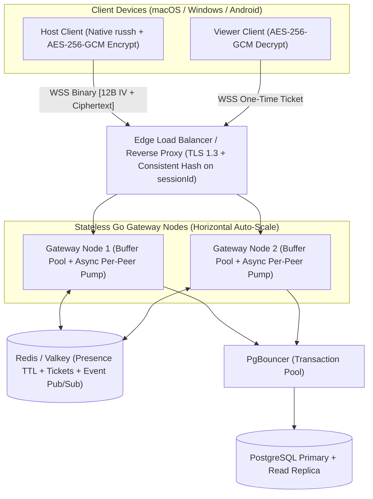

# ADR 0002: High-Scale Gateway & WebSocket Relay Roadmap

- **Status:** Planned (Trigger-Based Phased Rollout)
- **Date:** 2026-11-27
- **Context:** Scaling OpenTermius Gateway from single-node self-hosted teams (< 500 devices) to thousands/tens of thousands of concurrent customers while preserving Zero-Knowledge E2EE and low infrastructure cost.

---

## 1. Bottlenecks Identified in Current v0.7.x Baseline

1. **Per-Heartbeat SQL Lookup (`presence_usecase.go`):** `Heartbeat()` queries `userRepo.GetByID()` every 10 seconds per online device (`5,000 devices = 500 SQL queries/sec` just for presence).
2. **HTTP Polling Overhead (`App.svelte`):**
   - `POST /api/v1/presence/heartbeat` every `10s`.
   - `GET /api/v1/sessions/requests/:id` every `1.5s` while waiting for remote approval.
   - `GET /api/v1/vaults/:id/items` full list fetch every `30s` (`silentBackgroundSync`).
3. **Synchronous Fan-Out & Missing Dead-Peer Timeout (`collab_handler.go`):**
   - `RelayWS` loops synchronously over viewers (`v.send()`); one slow viewer connection can stall frame delivery to other viewers in the same room.
   - No `Ping`/`Pong` read deadline to reap half-open TCP zombie sockets.
   - JWT passed in `?token=` query string rather than a single-use ticket.
4. **In-Memory State (`rooms`, `devices`, `requests`):** Prevents running `>1` Gateway instance behind a round-robin load balancer without sticky sessions or shared state.

---

## 2. Target High-Scale Architecture

---

## 3. Phased Execution Plan (Build Only When Triggered)

### Phase 1: Single-Node Hardening (Up to ~5,000 Concurrent Devices on 1 VPS)
**Trigger:** Public internet Gateway deployment or `> 500` active devices.

1. **One-Time WebSocket Ticket (`POST /api/v1/relay/:sessionId/ticket`):**
   - Authenticated via `Authorization: Bearer <JWT>`.
   - Issues a 32-byte CSPRNG ticket (`TTL = 20s`, atomic single-use delete on upgrade) bound to `(user_id, session_id, role, mode)`.
   - Eliminates JWT leakage in reverse-proxy access logs.
2. **True End-to-End Encrypted (E2EE) Binary Relay Frames:**
   - Host encrypts PTY chunks in WebCrypto using the cached Vault Key (`AES-256-GCM`), framed as raw binary `[12-byte IV][ciphertext + 16-byte tag]` (only +28 bytes/frame, zero server CPU).
   - Sequential Promise queue on sender guarantees strict frame ordering during high-throughput output (`htop`, `cat`).
3. **Async Per-Viewer Send Buffer & Ping/Pong Reaping:**
   - Give each `relayPeer` a bounded `sendCh chan []byte` (cap `64`) and dedicated writer goroutine.
   - If `sendCh` fills up on a stalled viewer, disconnect that slow viewer immediately (`CloseGoingAway`) without blocking the host or other viewers.
   - Add `25s` server `PingMessage` ticker + `60s` `SetReadDeadline` refreshed on `Pong`.
4. **Eliminate Heartbeat SQL Queries:**
   - Cache `(userName, userEmail)` in memory (`TTL 10m`) instead of querying PostgreSQL on every 10s heartbeat.
   - Back off client heartbeat to `30s` when `terminalStore.tabCount === 0`.

### Phase 2: Multi-Node Horizontal Scale (5,000 – 50,000 Concurrent Devices)
**Trigger:** Single node CPU `> 60%` or zero-downtime multi-node High Availability needed.

1. **Event-Driven Control WebSocket (`/api/v1/events/ws`):**
   - Replace `10s` HTTP heartbeat, `1.5s` request polling, and `30s` blind vault polling with 1 persistent lightweight event socket per device.
   - Server pushes `remote_request`, `request_approved`, `presence_diff`, and `vault_updated` events in real time (cuts HTTP RPS by `> 90%`).
2. **Shared State & Multi-Node Relay:**
   - Move `devices`, `requests`, and `tickets` into **Redis / Valkey** with native key TTLs.
   - Route `/api/v1/relay/{sessionId}` using **Consistent Hashing on `sessionId`** at Nginx/Envoy (`hash $request_uri consistent;`) so all participants of one terminal room land on the same Go node with zero cross-node hop—or bridge rooms across regions via Redis/NATS Pub/Sub (`relay:{sessionId}`).
3. **WebSocket Memory Pooling:**
   - Configure `websocket.Upgrader{ WriteBufferPool: &sync.Pool{} }` and `4 KB` read/write buffers to keep memory under `~12 KB` per idle socket (`50,000 sockets ≈ 600 MB RAM`).

### Phase 3: 50,000+ SaaS Scale & Multi-Region
**Trigger:** `> 50,000` users or `> 1,000` DB writes/sec.

1. **Delta Vault Synchronization:**
   - Add `?since_version=<n>` or `?updated_after=<ts>` + soft-delete tombstones on `GET /api/v1/vaults/:id/items` so reconnect sync transfers only changed items instead of full vault snapshots.
2. **PgBouncer + Read Replicas:**
   - Place PgBouncer (transaction pooling) in front of PostgreSQL so `N` Gateway nodes share a fixed pool of `50–100` DB connections.
3. **OS & Runtime Tuning:**
   - Linux sysctl tuning (`fs.file-max`, `net.ipv4.ip_local_port_range`, `net.core.somaxconn`), `LimitNOFILE=1048576`, and Go `GOMEMLIMIT`.
